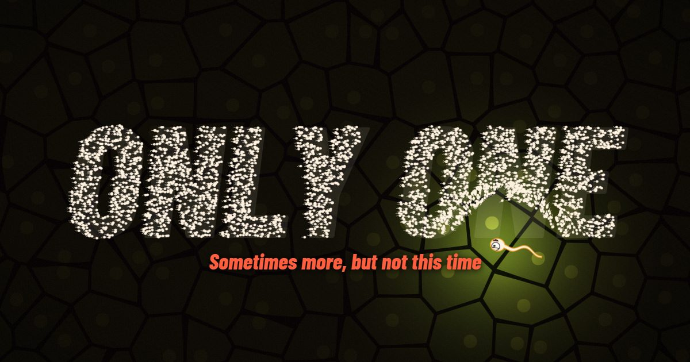

<div align="center">

# Only One

**Sometimes more, but not this time.**

De 300 millones, solo llega uno. Igual no eres tú.

[**Jugar ahora**](https://only-one.christianpasinrey.es/)



</div>

Only One es un juego incremental en 3D que se juega gratis en el navegador. Eres un espermatozoide con mala baba: nadas por cavernas orgánicas con niebla de guerra, comes azúcar, compras mejoras y aguantas los insultos de tus 300 millones de hermanos hasta llegar al óvulo.

> **Solo para mayores de 18.** Tacos, humor guarro y biología mal explicada.

## Cómo se juega

Cada partida son seis tramos, de El Vestíbulo Ácido a La Antesala, y cada uno es una cueva generada con su propia semilla.

- **Explora.** Buscas el camino a la salida y descubres el mapa. Los rincones esconden azúcar, cofres trucados y pruebas canallas.
- **Mejora.** El azúcar da ATP y el ATP se gasta en mejoras, como el Flagelo o el Cañón de lefa, sin soltar la carrera.
- **Sobrevive.** Los rivales avisan, embisten y escupen. Tienes corazones y vidas, y cada tramo superado es un checkpoint.
- **Derriba guardianes.** Manolo Turbo, Doctor Flagelo y El Cuñado sellan la salida de tres tramos. Solo les duele cuando se quedan sin aliento.
- **Colecciona.** Hay medallas por tramo y logros tipo «Hipertensión is coming» o «Conductor de BMW».
- **Vuelve a empezar.** Al ganar llega una nueva camada, con un rasgo heredado y más dureza.

Antes de salir eliges cromosoma X o Y, y eso cambia los insultos y el trato del narrador.

## Controles

| Acción | Teclado y ratón | Mando | Móvil |
| --- | --- | --- | --- |
| Nadar | WASD, flechas o clic | Stick izquierdo | Arrastrar el dedo o tocar un punto |
| Esprintar | Mayús o Espacio | RT o A | Botón Esprint |
| Lefazo con el Cañón de lefa | F, E o clic derecho | RB o X | Botón Lefazo, que apunta solo |
| Mejoras | Tab | LB | Botón Mejoras |
| Pausa | Esc | Start | Botón Pausa |

## Tecnología

Es una web estática, sin build ni dependencias que instalar.

- **Render:** Three.js r128 con materiales toon, contornos de tinta, bloom y suelo celular por shader.
- **Caras:** dibujadas en canvas al arrancar, frontales y de perfil, con ocho expresiones.
- **Mundo:** generador de cuevas con semilla, autómata celular y campos de flujo para que los rivales corran de verdad.
- **Sonido:** sintetizado con WebAudio, sin archivos de audio.
- **Landing:** enjambre de miles de instancias dibujadas por distance fields en WebGL. El scroll es la carrera.
- **Guardado:** `localStorage`. Sin cookies, registro ni analítica.

```text
.
├── index.html          Landing
├── assets/             Estilos y script de la landing, Three.js y fuentes
└── jugar/
    ├── index.html      Página del juego
    └── js/
        ├── data.js     Fases, mejoras, logros, insultos y ajustes
        ├── faces.js    Hojas de expresiones
        ├── maze.js     Generador de cuevas
        ├── render.js   Escena y shaders
        ├── game.js     Reglas
        ├── audio.js    Sonido
        ├── intro.js    Intro
        └── ui.js       Menús, HUD y controles
```

Casi todo el contenido y el equilibrio están en `jugar/js/data.js`, así que añadir insultos, logros o mejoras es añadir filas.

## Ejecutarlo en local

Cualquier servidor estático vale, por ejemplo:

```bash
python -m http.server 8000
```

Después abre <http://localhost:8000>.

## Despliegue

Sube el contenido del repositorio a la raíz pública de un dominio o subdominio. Las rutas son relativas y no hace falta configurar nada más. Si la web no va en `only-one.christianpasinrey.es`, cambia las URL de `og:url` y `og:image` en `index.html`.

## Créditos

Hecho por [Christian Pasín](https://github.com/christianpasinrey).

- [Three.js](https://threejs.org/), con licencia MIT.
- Tipografías [Barlow y Barlow Condensed](https://github.com/jpt/barlow), con licencia SIL Open Font License.
